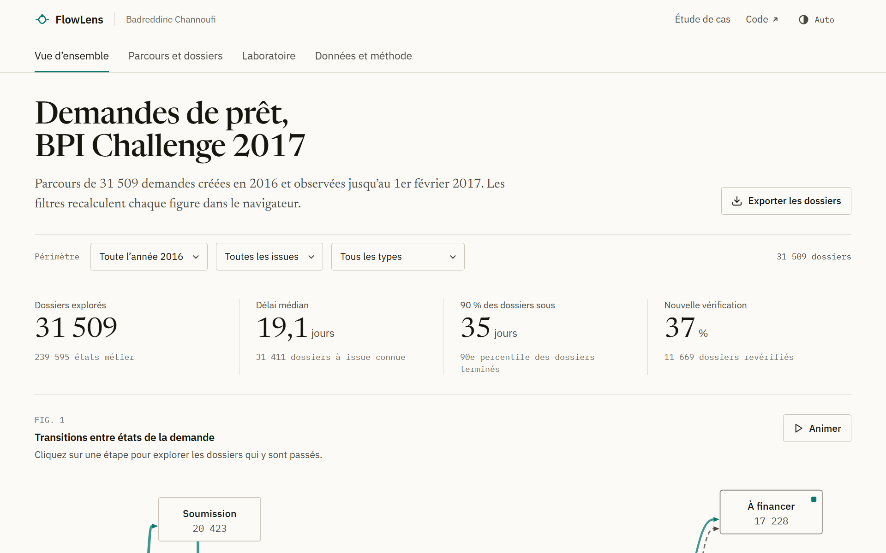
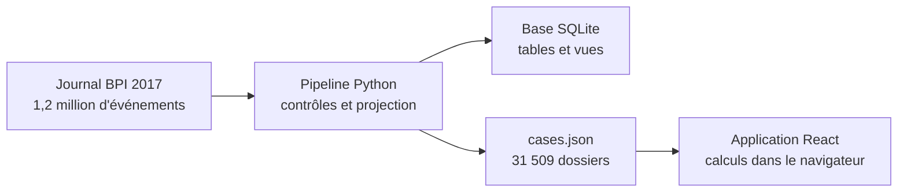

<p align="center">
  
</p>

<h1 align="center">FlowLens</h1>

<p align="center">
  Le parcours de 31 509 demandes de prêt, reconstitué étape par étape<br>
  à partir du journal d'événements public d'une banque néerlandaise.
</p>

<p align="center">
  <a href="https://badreddine05.github.io/flowlens/"><strong>Ouvrir l'application</strong></a>
  &nbsp;·&nbsp;
  <a href="https://badreddine05.github.io/projets/flowlens/">Lire l'étude de cas</a>
  &nbsp;·&nbsp;
  <a href="docs/METHODOLOGY.md">Méthodologie</a>
</p>

<picture>
  <source media="(prefers-color-scheme: dark)" srcset=".github/readme/flowlens-dark.png">
  
</picture>

## Le projet

Chaque demande de crédit laisse des traces dans le logiciel de la banque : création, préparation, vérification, décision, chacune avec son horodatage. FlowLens recoud ces traces dossier par dossier pour montrer le processus tel qu'il se déroule vraiment, avec ses détours et ses retours en arrière. Les données viennent du BPI Challenge 2017, un jeu public publié pour la recherche en process mining.

## Ce que l'on peut faire

L'application s'ouvre dans le navigateur, sans compte ni installation.

- Voir les dix étapes d'une demande et les transitions observées entre elles.
- Comparer les 102 parcours différents, du plus fréquent au plus rare.
- Chercher un dossier et lire sa chronologie, date par date.
- Filtrer par mois, type de demande, issue ou étape, puis exporter les dossiers retenus en CSV.
- Tester un scénario : retirer une part du temps passé après une étape et regarder ce que deviennent les délais.

L'onglet « Données et méthode » rappelle la source, l'empreinte du fichier, les contrôles et les définitions.

## Ce que montrent les données

- Les dix parcours les plus fréquents couvrent 77,8 % des dossiers. Le premier, 6 840 dossiers à lui seul, se termine par une annulation juste après « dossier complet ».
- Une demande terminée dure 19,1 jours en médiane. Les demandes financées ou refusées se règlent en deux semaines environ ; les annulations forment un pic net autour de 30 jours.
- 70 % du temps cumulé s'écoule après « dossier complet », l'étape qui précède le retour de l'offre signée par le client.
- 11 669 dossiers repassent plusieurs fois par la vérification. Leur durée médiane est plus courte que celle des autres, parce qu'ils sont presque toujours financés et rarement annulés.

Ce sont des constats sur un journal historique : ils ne mesurent ni un gain commercial ni un effet de cause à effet.

## Comment ça marche



Le pipeline télécharge le journal officiel, vérifie son empreinte et ne garde que les états de la demande elle-même. L'application charge le résultat en JSON et fait tous les calculs sur place : filtres, graphe, variantes, durées et scénarios.

## Essayer en local

Avec Node.js 22.12 ou plus récent :

```sh
npm ci
npm run dev
```

Les données sont déjà dans le dépôt. Pour les reconstruire depuis la source, lancer les tests ou construire l'image Docker, voir [docs/DEVELOPMENT.md](docs/DEVELOPMENT.md).

## Limites

- Seuls les états de la demande sont gardés. Les activités liées aux offres et aux employés sont écartées, ce qui empêche d'analyser la charge de travail.
- Les délais sont calendaires et mélangent attente et travail.
- « À financer » correspond à l'état `A_Pending` et ne prouve pas que le prêt a été versé.
- Le laboratoire retranche des jours de façon mécanique, sans modéliser les équipes, la capacité ni l'issue des dossiers.

## Sources et crédits

Données : van Dongen, B. (2017). *BPI Challenge 2017*. Version 1. 4TU.ResearchData. [doi:10.4121/uuid:5f3067df-f10b-45da-b98b-86ae4c7a310b](https://doi.org/10.4121/uuid:5f3067df-f10b-45da-b98b-86ae4c7a310b). Elles relèvent des conditions générales de 4TU (attribution, usage non commercial), pas de la licence du code : voir [DATA_LICENSE.md](DATA_LICENSE.md).

Code sous licence [MIT](LICENSE). Polices Newsreader, IBM Plex Sans et IBM Plex Mono (SIL OFL 1.1) et licences de React et Lucide dans [`public/licenses/`](public/licenses/), détail dans [THIRD_PARTY_NOTICES.md](THIRD_PARTY_NOTICES.md).

Projet personnel de [Badreddine Channoufi](https://badreddine05.github.io/), réalisé avec l'aide d'outils d'IA. Les années 2016 et 2017 sont celles des données, pas de la réalisation du projet.

<details>
<summary>English summary</summary>

FlowLens rebuilds the path of each of the 31,509 loan applications in the public BPI Challenge 2017 event log. A standard-library Python pipeline projects application states into SQLite and a static JSON file. A React app then shows the process map, trace variants, durations, case timelines and explicit what-if scenarios, all computed in the browser. It is a descriptive, non-commercial study of a historical log.

</details>
