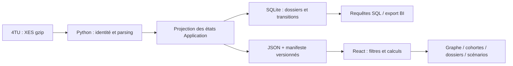

# Architecture et décisions

## Pourquoi une application statique ?

Le jeu historique est stable et sa taille permet un calcul local. Une démo statique facilite la reproduction, évite les clés d’accès et les coûts de serveur, et permet un hébergement GitHub Pages. La contrepartie est le transfert du jeu complet au premier chargement et un calcul sur le thread principal.

Pour des journaux volumineux ou fréquemment mis à jour : ingestion orchestrée, partitionnement Parquet par date, contrats de données, calculs SQL côté serveur, API paginée et authentification adaptée. Ce sont des évolutions envisagées, pas des fonctionnalités livrées.

## Pourquoi projeter les états Application ?

Le fichier contient activités d’offre et cycle de vie des tâches, parfois entremêlés. Les états Application forment une projection métier compréhensible pour une première analyse. Cette décision réduit la complexité tout en conservant toutes les traces. Elle interdit cependant de qualifier les intervalles de « temps de travail » ou de déduire la productivité d’un employé.

## Pourquoi ne pas entraîner un modèle prédictif ?

La question traitée est descriptive et exploratoire. Ajouter une prédiction sans définir son usage, ses variables disponibles à l’instant de décision et une validation temporelle apporterait une précision apparente. Le laboratoire est un modèle arithmétique explicite, pas du machine learning.

## Responsabilités

- `pipeline/build.py` : source, contrôle d’identité, projection minimale, exports.
- `sql/` : schéma durable et requêtes autonomes, indépendantes de React.
- `src/analytics.mjs` : fonctions pures de calcul, testées sans navigateur.
- `src/main.jsx` : composants, interaction et présentation.
- `src/styles.css` : système visuel, états de focus, responsive et mouvement réduit.

## Confidentialité et surface technique

L’artefact public ne contient que des identifiants de substitution, timestamps, type de demande, états et comptes. Il n’expose pas les attributs financiers ou employés du fichier brut. Aucun formulaire de saisie externe n’est envoyé, aucune authentification n’est requise et aucun secret n’est embarqué. Les liens externes s’ouvrent avec `rel=noreferrer`.

Le dossier brut et les sorties SQL/CSV complètes sont exclus de Git. Les données JSON dérivées restent soumises à leurs conditions propres, distinctes du code.

## Reproductibilité

Le SHA-256 source est figé dans le manifeste. Le pipeline ne contient ni génération aléatoire, ni date système dans les calculs. La version Node est testée en CI, les dépendances npm sont verrouillées dans `package-lock.json`, et Python n’exige aucun paquet tiers. Les tests de conservation contrôlent toutes les traces du jeu public.
